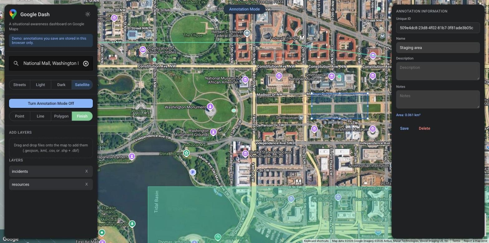

# Google Dash

Google Dash is a situational-awareness dashboard generator on Google Cloud. It connects to your
data sources, lets your team annotate a Google Map together, and shares that knowledge with
stakeholders. The flow: configure → load a basemap → search → drag-and-drop data → draw and
annotate → persist.

**Live demo:** [briandaviddavidson.com/google-dash](https://briandaviddavidson.com/google-dash/)
(annotations you save there stay in your browser).



## Features

1. Google Maps base with a swappable basemap toggle (Streets / Light / Dark / Satellite)
2. Places search bar
3. Drag-and-drop data layers: `.geojson`/`.json`, `.kml`, `.csv` (with lat/lon columns), and
   `.shp` (drop the matching `.dbf` too to keep attributes)
4. Annotation mode: draw points, lines and polygons, see their length or area, add metadata, and save them
5. Pluggable storage: Firestore, Cloud Storage, in-memory (dev), or the visitor's browser (demos)
6. Google sign-in with an email/domain allowlist for anyone who can edit

## Requirements

- Node 20+
- A **Google Maps JavaScript API key** with the Maps JavaScript API and Places API (New) enabled
  ([get one](https://console.cloud.google.com/google/maps-apis)). Restrict it by HTTP referrer to
  your Hosting domain.
- For a deployed API: a GCP project with Firebase Authentication (Google provider) and either a
  Firestore database or a Cloud Storage bucket.

## Getting started

```bash
git clone git@github.com:briandaviddavidson/google-dash.git
cd google-dash
npm ci
npm run config        # interactive setup wizard; writes .env
npm run dev           # Vite dev server (:1234) + API (:3000)
```

`npm run config` asks for your dashboard info, Maps API key, GCP project, where annotations are
stored, and whether editing requires sign-in. It writes a single `.env` used by both the frontend
(`VITE_*` vars) and the server. You can also copy `.env.example` to `.env` and fill it in by hand;
it's set up for local development with in-memory storage and sign-in turned off.

### Storage

`VITE_STORAGE_MODE` picks where the frontend keeps annotations:

| `VITE_STORAGE_MODE` | Behavior |
| --- | --- |
| `api` (default) | Calls the Express API, which stores annotations in the `STORAGE_BACKEND` below. |
| `local` | Keeps annotations in the visitor's `localStorage`. No server and nothing shared, so it's safe for a public demo. |

In `api` mode, `STORAGE_BACKEND` picks the server's store:

| `STORAGE_BACKEND` | Behavior |
| --- | --- |
| `firestore` | One document per annotation in `FIRESTORE_COLLECTION`. Honors `FIRESTORE_EMULATOR_HOST` for local dev. |
| `gcs` | All annotations in a single GeoJSON object (`GCS_OBJECT`) in `GCS_BUCKET`; read-modify-write per change. |
| `memory` | Non-persistent, zero-setup local dev. |

The server reaches Google Cloud with [Application Default Credentials](https://cloud.google.com/docs/authentication/application-default-credentials)
(`gcloud auth application-default login` locally; the Cloud Run service account in production).

### Who can edit

Writes and deletes require a signed-in Google user on the allowlist:

1. In the Firebase console for your project, enable **Authentication → Sign-in method → Google**,
   and add your Hosting domain under **Authorized domains**.
2. Set the frontend's Firebase web config: `VITE_FIREBASE_API_KEY`, `VITE_FIREBASE_AUTH_DOMAIN`,
   `VITE_FIREBASE_PROJECT_ID`. The app then shows a **Sign in with Google** button, and annotation
   mode stays off until you sign in.
3. Set `ALLOWED_EMAILS` on the server to the people (`ana@example.com`) or whole domains
   (`@example.com`) who may edit, comma-separated. The server verifies each request's Firebase ID
   token and refuses to start without an allowlist.

| Server variable | Default | Meaning |
| --- | --- | --- |
| `ALLOWED_EMAILS` | (required) | Emails and/or `@domains` allowed to edit |
| `PUBLIC_READ` | `true` | Let anyone view annotations; set `false` to require sign-in to read |
| `AUTH_DISABLED` | `false` | Skip sign-in entirely. **Local development only.** |
| `ALLOWED_ORIGINS` | (empty) | Origins allowed to call the API cross-origin, e.g. the Vite dev server. Leave empty in production, where Hosting rewrites make calls same-origin. |

## Project layout

```
src/        Frontend (Vite + TS): map, layers, annotations, storage (api.ts), sign-in (auth.ts)
server/     API (Express 5): app.ts (routes, auth, validation), auth.ts, storage/ adapters
scripts/    config.ts, the npm run config wizard
data/       sample data.geojson for drag-and-drop testing
public/     static assets (logo, favicon)
```

The API exposes `POST /saveannotation`, `GET /getannotations`, `POST /deleteannotation`, and
`GET /health`.

## Development

```bash
npm run typecheck
npm test              # Vitest + Supertest: API auth, validation, CORS, storage
npm run build         # frontend -> dist/
npm run build:server  # API -> build/server/
```

CI runs all of these, audits production dependencies, and builds and smoke-tests the Docker image.

## Deployment

**API → Cloud Run.** The Dockerfile compiles the server and runs it with production dependencies
only. Grant the service account Firestore or Storage access, then:

```bash
gcloud run deploy google-dash-api --source . --region us-central1 \
  --set-env-vars STORAGE_BACKEND=firestore,GCP_PROJECT_ID=your-project,FIRESTORE_COLLECTION=annotations,ALLOWED_EMAILS=you@example.com
```

**Frontend → Firebase Hosting.** Set `VITE_API_BASE_URL=` (empty) so the app calls the API
same-origin through the rewrites in `firebase.json`, then:

```bash
npm run build
npx firebase-tools deploy --only hosting
```

`firebase.json` rewrites the API routes to the `google-dash-api` Cloud Run service (update
`serviceId`/`region` if you change them).

**Static demo.** Build in `local` mode under any path, with no API:

```bash
VITE_STORAGE_MODE=local npx vite build --base /google-dash/
```

## Built with

- [Google Maps JavaScript API](https://developers.google.com/maps/documentation/javascript): map, Places, geometry
- [Firebase Authentication](https://firebase.google.com/docs/auth) and [firebase-admin](https://firebase.google.com/docs/admin/setup): sign-in and token checks
- [Firestore](https://cloud.google.com/firestore) / [Cloud Storage](https://cloud.google.com/storage): annotation storage
- [Cloud Run](https://cloud.google.com/run) and [Firebase Hosting](https://firebase.google.com/docs/hosting): hosting
- [Vite](https://vitejs.dev/), [TypeScript](https://www.typescriptlang.org/), [Express](https://expressjs.com/), [Vitest](https://vitest.dev/)
- [csv2geojson](https://github.com/mapbox/csv2geojson), [@tmcw/togeojson](https://github.com/placemark/togeojson), [shapefile](https://github.com/mbostock/shapefile): file conversion

## License

MIT
